# Atlantik-Brücke – direkte Beziehungen

**49 quellengebundene Beziehungen** mit Atlantik-Brücke als Ausgangs- oder Zielakteur. Die Ansicht zeigt **nur unmittelbare Relationen**; sie beweist weder gemeinsame Steuerung noch Beziehungen zwischen den übrigen dargestellten Akteuren.

[Alle Fokusansichten](network-graph.md) · [Vollständige Relationstabelle](network.md)

```mermaid
flowchart LR
    N_ORG_DE_ATLANTIK_BRUECKE["Atlantik-Brücke e.V."]
    N_PRG_DE_ATLANTIK_BRUECKE_YOUNG_LEADERS["Atlantik-Brücke Young Leaders Program"]
    N_ORG_DE_ATLANTIK_BRUECKE -->|"betreibt"| N_PRG_DE_ATLANTIK_BRUECKE_YOUNG_LEADERS
    N_PER_DE_MATTHIAS_NASS["Matthias Naß"]
    N_PER_DE_MATTHIAS_NASS -->|"moderierte NATO-Diskussion"| N_ORG_DE_ATLANTIK_BRUECKE
    N_PER_DE_TINA_HASSEL["Tina Hassel"]
    N_PER_DE_TINA_HASSEL -->|"Gesprächspartnerin bei Deutsch-Amerikanischer Konferenz"| N_ORG_DE_ATLANTIK_BRUECKE
    N_PER_DE_GEORG_MASCOLO["Georg Mascolo"]
    N_PER_DE_GEORG_MASCOLO -->|"Panelteilnehmer Deutsch-Amerikanische Konferenz"| N_ORG_DE_ATLANTIK_BRUECKE
    N_PER_DE_TOM_BUHROW["Tom Buhrow"]
    N_PER_DE_TOM_BUHROW -->|"in Emersons Abschiedsrede direkt angesprochen"| N_ORG_DE_ATLANTIK_BRUECKE
    N_PER_DE_GABOR_STEINGART["Gabor Steingart"]
    N_PER_DE_GABOR_STEINGART -->|"moderierte Gespräch zur US-Präsidentschaftswahl"| N_ORG_DE_ATLANTIK_BRUECKE
    N_PER_DE_SVEN_AFHUEPPE["Sven Afhüppe"]
    N_PER_DE_SVEN_AFHUEPPE -->|"als Mitglied bezeichnet"| N_ORG_DE_ATLANTIK_BRUECKE
    N_PER_DE_SVEN_AFHUEPPE -->|"moderierte Industrie-4.0-Veranstaltung"| N_ORG_DE_ATLANTIK_BRUECKE
    N_PER_DE_STEFAN_KORNELIUS["Stefan Kornelius"]
    N_PER_DE_STEFAN_KORNELIUS -->|"Gastredner bei Young Leaders-Konferenz"| N_ORG_DE_ATLANTIK_BRUECKE
    N_PER_DE_KLAUS_DIETER_FRANKENBERGER["Klaus-Dieter Frankenberger"]
    N_PER_DE_KLAUS_DIETER_FRANKENBERGER -->|"Redner bei Deutsch-Amerikanischer Konferenz"| N_ORG_DE_ATLANTIK_BRUECKE
    N_PER_DE_KAI_DIEKMANN["Kai Diekmann"]
    N_PER_DE_KAI_DIEKMANN -->|"Vorstandsmitglied"| N_ORG_DE_ATLANTIK_BRUECKE
    N_PER_DE_ELMAR_THEVESSEN["Elmar Theveßen"]
    N_PER_DE_ELMAR_THEVESSEN -->|"als Mitglied bezeichnet"| N_ORG_DE_ATLANTIK_BRUECKE
    N_PER_DE_CLAUS_KLEBER["Claus Kleber"]
    N_PER_DE_CLAUS_KLEBER -->|"als Moderator der Diskussion angekündigt"| N_ORG_DE_ATLANTIK_BRUECKE
    N_PER_DE_HUBERT_BURDA["Hubert Burda"]
    N_PER_DE_HUBERT_BURDA -->|"im 2003-Faksimile als beitragende Person im Kreis von Mitgliedern und Freunden aufgeführt"| N_ORG_DE_ATLANTIK_BRUECKE
    N_PER_DE_JOSEF_JOFFE["Josef Joffe"]
    N_PER_DE_JOSEF_JOFFE -->|"im 2003-Faksimile als beitragende Person im Kreis von Mitgliedern und Freunden aufgeführt"| N_ORG_DE_ATLANTIK_BRUECKE
    N_PER_DE_DIETER_VON_HOLTZBRINCK["Dieter von Holtzbrinck"]
    N_PER_DE_DIETER_VON_HOLTZBRINCK -->|"im 2003-Faksimile als beitragende Person im Kreis von Mitgliedern und Freunden aufgeführt"| N_ORG_DE_ATLANTIK_BRUECKE
    N_PER_DE_STEFAN_VON_HOLTZBRINCK["Stefan von Holtzbrinck"]
    N_PER_DE_STEFAN_VON_HOLTZBRINCK -->|"im 2003-Faksimile als beitragende Person im Kreis von Mitgliedern und Freunden aufgeführt"| N_ORG_DE_ATLANTIK_BRUECKE
    N_PER_DE_FRIEDE_SPRINGER["Friede Springer"]
    N_PER_DE_FRIEDE_SPRINGER -->|"im 2003-Faksimile als beitragende Person im Kreis von Mitgliedern und Freunden aufgeführt"| N_ORG_DE_ATLANTIK_BRUECKE
    N_PER_DE_MATHIAS_DOEPFNER["Mathias Döpfner"]
    N_PER_DE_MATHIAS_DOEPFNER -->|"im 2003-Faksimile als beitragende Person im Kreis von Mitgliedern und Freunden aufgeführt"| N_ORG_DE_ATLANTIK_BRUECKE
    N_PER_DE_KAI_DIEKMANN -->|"im 2003-Faksimile als beitragende Person im Kreis von Mitgliedern und Freunden aufgeführt"| N_ORG_DE_ATLANTIK_BRUECKE
    N_PER_DE_JULIA_JAEKEL["Julia Jäkel"]
    N_PER_DE_JULIA_JAEKEL -->|"im 2003-Faksimile als beitragende Person im Kreis von Mitgliedern und Freunden aufgeführt"| N_ORG_DE_ATLANTIK_BRUECKE
    N_PER_DE_THEO_KOLL["Theo Koll"]
    N_PER_DE_THEO_KOLL -->|"im 2003-Faksimile als beitragende Person im Kreis von Mitgliedern und Freunden aufgeführt"| N_ORG_DE_ATLANTIK_BRUECKE
    N_PER_DE_THOMAS_RABE["Thomas Rabe"]
    N_PER_DE_THOMAS_RABE -->|"bei gemeinsamem Atlantik-Brücke/Bertelsmann-Format dokumentiert"| N_ORG_DE_ATLANTIK_BRUECKE
    N_PER_DE_LIZ_MOHN["Liz Mohn"]
    N_PER_DE_LIZ_MOHN -->|"erhielt den XIV. Vernon A. Walters Award"| N_ORG_DE_ATLANTIK_BRUECKE
    N_PER_DE_ULRICH_WILHELM["Ulrich Wilhelm"]
    N_PER_DE_ULRICH_WILHELM -->|"Gastredner beim World-Young-Leaders-Treffen"| N_ORG_DE_ATLANTIK_BRUECKE
    N_PER_DE_PETER_FREY["Peter Frey"]
    N_PER_DE_PETER_FREY -->|"Redner beim Frankfurt Luncheon zum Fernsehen in der digitalen Öffentlichkeit"| N_ORG_DE_ATLANTIK_BRUECKE
    N_PER_DE_JOERG_SCHOENENBORN["Jörg Schönenborn"]
    N_PER_DE_JOERG_SCHOENENBORN -->|"Gesprächspartner des US-Botschafters Philip D. Murphy"| N_ORG_DE_ATLANTIK_BRUECKE
    N_PER_DE_KLAUS_DIETER_FRANKENBERGER -->|"gab eine Einführung bei der 79. Sitzung des Arbeitskreises USA"| N_ORG_DE_ATLANTIK_BRUECKE
    N_PER_DE_JOERG_QUOOS["Jörg Quoos"]
    N_PER_DE_JOERG_QUOOS -->|"Gesprächspartner einer von der Atlantik-Brücke organisierten Journalistenreise"| N_ORG_DE_ATLANTIK_BRUECKE
    N_PER_DE_INGO_ZAMPERONI["Ingo Zamperoni"]
    N_PER_DE_INGO_ZAMPERONI -->|"Teilnehmer eines Working Lunch mit Admiral James G. Stavridis"| N_ORG_DE_ATLANTIK_BRUECKE
    N_PER_DE_THOMAS_ROTH["Thomas Roth"]
    N_PER_DE_THOMAS_ROTH -->|"in der Dokumentation der Deutsch-Amerikanischen Konferenz 2015 aufgeführt"| N_ORG_DE_ATLANTIK_BRUECKE
    N_PER_DE_THEO_SOMMER["Theo Sommer"]
    N_PER_DE_THEO_SOMMER -->|"Gesprächspartner einer von der Atlantik-Brücke organisierten Journalistenreise"| N_ORG_DE_ATLANTIK_BRUECKE
    N_PER_DE_CLAUS_KLEBER -->|"hielt die XX. Karl-Heinz-Beckurts-Gedächtnisrede"| N_ORG_DE_ATLANTIK_BRUECKE
    N_PRG_DE_ATLANTIK_BRUECKE_NEW_BRIDGE["Atlantik-Brücke New Bridge Program"]
    N_ORG_DE_ATLANTIK_BRUECKE -->|"betreibt New Bridge Program (New Bridge to Germany seit 2021)"| N_PRG_DE_ATLANTIK_BRUECKE_NEW_BRIDGE
    N_ORG_US_HALLE_FOUNDATION["The Halle Foundation"]
    N_ORG_US_HALLE_FOUNDATION -->|"bewilligte 47.525 USD für New Bridge 2022; keine ausgezahlte Summe nachgewiesen"| N_ORG_DE_ATLANTIK_BRUECKE
    N_ORG_US_HALLE_FOUNDATION -->|"bewilligte 40.000 USD für New Bridge 2023; keine ausgezahlte Summe nachgewiesen"| N_ORG_DE_ATLANTIK_BRUECKE
    N_PER_DE_WALTHER_LEISLER_KIEP["Walther Leisler Kiep (1926–2016)"]
    N_PER_DE_WALTHER_LEISLER_KIEP -->|"Atlantik-Brücke-Jahresbericht zum 30.06.2009 trägt die Unterschrift Walther Leisler Kieps als Ehrenvorsitzendem; nicht gleichbedeutend mit einem Vorstandsbeschluss über seinen TH-495-Lobbybrief von 1993"| N_ORG_DE_ATLANTIK_BRUECKE
    N_PER_DE_KARLHEINZ_SCHREIBER["Karlheinz Schreiber"]
    N_PER_DE_KARLHEINZ_SCHREIBER -->|"Bundestags-Untersuchungsausschuss Drs. 14/9300 nennt Schreiber im Zusammenhang mit den frühen 1990er Jahren Mitglied der Atlantik-Brücke; Höhe eines Vereinsbeitrags oder Vorstandsvollmacht nicht nachgewiesen"| N_ORG_DE_ATLANTIK_BRUECKE
    N_ORG_DE_AUSWAERTIGES_AMT_2008["Auswärtiges Amt"]
    N_ORG_DE_AUSWAERTIGES_AMT_2008 -->|"Atlantik-Brücke-Jahresbericht Juni 2008–Juni 2009 nennt das Auswärtige Amt ausdrücklich unter den Sponsoren; konkrete Haushaltsstelle, Zahlbetrag und Gegenleistungen im Beleg offen"| N_ORG_DE_ATLANTIK_BRUECKE
    N_ORG_DE_DEUTSCHE_BANK_2008["Deutsche Bank (Sponsor im Atlantik-Brücke-Jahresbericht 2008/09)"]
    N_ORG_DE_DEUTSCHE_BANK_2008 -->|"Atlantik-Brücke-Jahresbericht 2008/09 nennt Deutsche Bank als Sponsor; Betrag, Rechtsform der Unterstützung und konkrete Gegenleistung nicht angegeben"| N_ORG_DE_ATLANTIK_BRUECKE
    N_ORG_DE_DZ_BANK_2008["DZ BANK (Sponsor 2008/09)"]
    N_ORG_DE_DZ_BANK_2008 -->|"Jahresbericht Atlantik-Brücke 2008/09 nennt DZ BANK ausdrücklich unter acht Sponsoren, ohne individuellen Betrag oder Zweckvertrag"| N_ORG_DE_ATLANTIK_BRUECKE
    N_ORG_DE_MM_WARBURG["M. M. Warburg & CO"]
    N_ORG_DE_MM_WARBURG -->|"Atlantik-Brücke-Jahresbericht 2008/09 nennt M. M. Warburg Bank unter den Sponsoren; Sponsorennennung beweist keinen bezifferten Geldtransfer oder Einfluss auf konkrete Politikentscheidungen"| N_ORG_DE_ATLANTIK_BRUECKE
    N_ORG_DE_BUNDESBANK_2008["Deutsche Bundesbank (Sponsor 2008/09)"]
    N_ORG_DE_BUNDESBANK_2008 -->|"Jahresbericht Atlantik-Brücke 2008/09 nennt Deutsche Bundesbank als Sponsor; genaue Unterstützungsart und Betrag sowie heutige Förderung nicht daraus ableitbar"| N_ORG_DE_ATLANTIK_BRUECKE
    N_ORG_DE_VOLKSWAGEN_2008["Volkswagen (Sponsor 2008/09)"]
    N_ORG_DE_VOLKSWAGEN_2008 -->|"Atlantik-Brücke bezeichnet Volkswagen im historischen Jahresbericht 2008/09 ausdrücklich als Sponsor; kein dokumentierter Einzelbetrag oder Kauf politischer Entscheidungen"| N_ORG_DE_ATLANTIK_BRUECKE
    N_ORG_DE_STIFTUNG_VAN_MEETEREN["Stiftung van Meeteren (Sponsor 2008/09)"]
    N_ORG_DE_STIFTUNG_VAN_MEETEREN -->|"Atlantik-Brücke-Jahresbericht 2008/09 nennt Stiftung van Meeteren als Sponsor; Stiftungsbewilligung und individueller Geldfluss nicht ausgewiesen"| N_ORG_DE_ATLANTIK_BRUECKE
    N_ORG_DE_BERTELSMANN_STIFTUNG_2008["Bertelsmann Stiftung (Sponsor 2008/09)"]
    N_ORG_DE_BERTELSMANN_STIFTUNG_2008 -->|"Bertelsmann Stiftung wird in der Sponsorenliste des Atlantik-Brücke-Jahresberichts 2008/09 genannt, ohne ausgewiesenen Förderbetrag und ohne Beleg einer konkreten Einflussanweisung"| N_ORG_DE_ATLANTIK_BRUECKE
    N_ORG_DE_DEUTSCHE_BANK_2008 -->|"Atlantik-Brücke-Jahresbericht 2008/09 S. 82–83: XVII. Expertengespräch mit U.S. European Command und Bundeswehrführung am 16.09.2008 auf Einladung der Deutschen Bank in ihrer Berliner Hauptstadtrepräsentanz; Gastgeberrolle ist kein Beleg einer Waffenbeschaffungsentscheidung"| N_ORG_DE_ATLANTIK_BRUECKE
    N_PRG_DE_AB_JOURNALISTS_1983_1992["Atlantik-Brücke-Journalistenreisen für US-Medienschaffende 1983–1992"]
    N_ORG_DE_ATLANTIK_BRUECKE -->|"Pechels Brief vom 23.01.1992 als Atlantik-Brücke-Kuratoriumsmitglied beschreibt seit 1983 organisierte US-Journalistenreisen mit laut Organisator 121 Teilnehmenden bis 1991; vollständige Namens- und Artikelprüflisten liegen hier nicht vor"| N_PRG_DE_AB_JOURNALISTS_1983_1992
    N_PER_DE_PETER_E_PECHEL["Peter E. Pechel"]
    N_PER_DE_PETER_E_PECHEL -->|"Peter E. Pechel nennt sich im am 23.01.1992 reproduzierten Schreiben Mitglied des Kuratoriums der Atlantik-Brücke; seine Angaben zu Teilnehmerzahlen bleiben Organisatorberichte"| N_ORG_DE_ATLANTIK_BRUECKE
```

## Quellen und Evidenz

| Relation | Richtung und anderer Akteur | Befund | Evidenz | Quellen |
|---|---|---|---|---|
| [REL-DE-AB-NEW-BRIDGE-001](network.md#rel-de-ab-new-bridge-001) | → Atlantik-Brücke New Bridge Program | betreibt New Bridge Program (New Bridge to Germany seit 2021) | belegt | [SRC-DE-AB-NEWBRIDGE-PROGRAM-2026](../quellen/index.md#src-de-ab-newbridge-program-2026) |
| [REL-DE-AB-001](network.md#rel-de-ab-001) | → Atlantik-Brücke Young Leaders Program | betreibt | belegt | [SRC-DE-ATLANTIKBRUECKE-YL](../quellen/index.md#src-de-atlantikbruecke-yl) |
| [REL-DE-AB-JOUR-ORGANIZED-1983-001](network.md#rel-de-ab-jour-organized-1983-001) | → Atlantik-Brücke-Journalistenreisen für US-Medienschaffende 1983–1992 | Pechels Brief vom 23.01.1992 als Atlantik-Brücke-Kuratoriumsmitglied beschreibt seit 1983 organisierte US-Journalistenreisen mit laut Organisator 121 Teilnehmenden bis 1991; vollständige Namens- und Artikelprüflisten liegen hier nicht vor | stark gestützt | [SRC-DE-ZEITST-PECHEL-BUCERIUS-1992](../quellen/index.md#src-de-zeitst-pechel-bucerius-1992) |
| [REL-DE-AB-AA-SPONSOR-2009-001](network.md#rel-de-ab-aa-sponsor-2009-001) | ← Auswärtiges Amt | Atlantik-Brücke-Jahresbericht Juni 2008–Juni 2009 nennt das Auswärtige Amt ausdrücklich unter den Sponsoren; konkrete Haushaltsstelle, Zahlbetrag und Gegenleistungen im Beleg offen | stark gestützt | [SRC-DE-AB-JB-2008-2009](../quellen/index.md#src-de-ab-jb-2008-2009) |
| [REL-DE-AB-BERTELSMANN-SPONSOR-2009-001](network.md#rel-de-ab-bertelsmann-sponsor-2009-001) | ← Bertelsmann Stiftung (Sponsor 2008/09) | Bertelsmann Stiftung wird in der Sponsorenliste des Atlantik-Brücke-Jahresberichts 2008/09 genannt, ohne ausgewiesenen Förderbetrag und ohne Beleg einer konkreten Einflussanweisung | stark gestützt | [SRC-DE-AB-JB-2008-2009](../quellen/index.md#src-de-ab-jb-2008-2009) |
| [REL-DE-TMN-023](network.md#rel-de-tmn-023) | ← Claus Kleber | als Moderator der Diskussion angekündigt | belegt | [SRC-DE-AB-KLEBER-2026](../quellen/index.md#src-de-ab-kleber-2026) |
| [REL-DE-TMN-050](network.md#rel-de-tmn-050) | ← Claus Kleber | hielt die XX. Karl-Heinz-Beckurts-Gedächtnisrede | stark gestützt | [SRC-DE-AB-JB-2006-2007](../quellen/index.md#src-de-ab-jb-2006-2007) |
| [REL-DE-AB-DB-EUCOM-HOST-2008-001](network.md#rel-de-ab-db-eucom-host-2008-001) | ← Deutsche Bank (Sponsor im Atlantik-Brücke-Jahresbericht 2008/09) | Atlantik-Brücke-Jahresbericht 2008/09 S. 82–83: XVII. Expertengespräch mit U.S. European Command und Bundeswehrführung am 16.09.2008 auf Einladung der Deutschen Bank in ihrer Berliner Hauptstadtrepräsentanz; Gastgeberrolle ist kein Beleg einer Waffenbeschaffungsentscheidung | stark gestützt | [SRC-DE-AB-JB-2008-2009](../quellen/index.md#src-de-ab-jb-2008-2009) |
| [REL-DE-AB-DEUTSCHEBANK-SPONSOR-2009-001](network.md#rel-de-ab-deutschebank-sponsor-2009-001) | ← Deutsche Bank (Sponsor im Atlantik-Brücke-Jahresbericht 2008/09) | Atlantik-Brücke-Jahresbericht 2008/09 nennt Deutsche Bank als Sponsor; Betrag, Rechtsform der Unterstützung und konkrete Gegenleistung nicht angegeben | stark gestützt | [SRC-DE-AB-JB-2008-2009](../quellen/index.md#src-de-ab-jb-2008-2009) |
| [REL-DE-AB-BUNDESBANK-SPONSOR-2009-001](network.md#rel-de-ab-bundesbank-sponsor-2009-001) | ← Deutsche Bundesbank (Sponsor 2008/09) | Jahresbericht Atlantik-Brücke 2008/09 nennt Deutsche Bundesbank als Sponsor; genaue Unterstützungsart und Betrag sowie heutige Förderung nicht daraus ableitbar | stark gestützt | [SRC-DE-AB-JB-2008-2009](../quellen/index.md#src-de-ab-jb-2008-2009) |
| [REL-DE-TMN-033](network.md#rel-de-tmn-033) | ← Dieter von Holtzbrinck | im 2003-Faksimile als beitragende Person im Kreis von Mitgliedern und Freunden aufgeführt | stark gestützt | [SRC-DE-AB-MESSAGE-2003-MIRROR](../quellen/index.md#src-de-ab-message-2003-mirror) |
| [REL-DE-AB-DZBANK-SPONSOR-2009-001](network.md#rel-de-ab-dzbank-sponsor-2009-001) | ← DZ BANK (Sponsor 2008/09) | Jahresbericht Atlantik-Brücke 2008/09 nennt DZ BANK ausdrücklich unter acht Sponsoren, ohne individuellen Betrag oder Zweckvertrag | stark gestützt | [SRC-DE-AB-JB-2008-2009](../quellen/index.md#src-de-ab-jb-2008-2009) |
| [REL-DE-TMN-021](network.md#rel-de-tmn-021) | ← Elmar Theveßen | als Mitglied bezeichnet | belegt | [SRC-DE-AB-THEVESSEN-2024](../quellen/index.md#src-de-ab-thevessen-2024) |
| [REL-DE-TMN-035](network.md#rel-de-tmn-035) | ← Friede Springer | im 2003-Faksimile als beitragende Person im Kreis von Mitgliedern und Freunden aufgeführt | stark gestützt | [SRC-DE-AB-MESSAGE-2003-MIRROR](../quellen/index.md#src-de-ab-message-2003-mirror) |
| [REL-DE-TMN-010](network.md#rel-de-tmn-010) | ← Gabor Steingart | moderierte Gespräch zur US-Präsidentschaftswahl | belegt | [SRC-DE-AB-STEINGART-2016](../quellen/index.md#src-de-ab-steingart-2016) |
| [REL-DE-TMN-007](network.md#rel-de-tmn-007) | ← Georg Mascolo | Panelteilnehmer Deutsch-Amerikanische Konferenz | belegt | [SRC-DE-AB-CONFERENCE-2017](../quellen/index.md#src-de-ab-conference-2017) |
| [REL-DE-TMN-031](network.md#rel-de-tmn-031) | ← Hubert Burda | im 2003-Faksimile als beitragende Person im Kreis von Mitgliedern und Freunden aufgeführt | stark gestützt | [SRC-DE-AB-MESSAGE-2003-MIRROR](../quellen/index.md#src-de-ab-message-2003-mirror) |
| [REL-DE-TMN-047](network.md#rel-de-tmn-047) | ← Ingo Zamperoni | Teilnehmer eines Working Lunch mit Admiral James G. Stavridis | stark gestützt | [SRC-DE-AB-JB-2011-2012](../quellen/index.md#src-de-ab-jb-2011-2012) |
| [REL-DE-TMN-032](network.md#rel-de-tmn-032) | ← Josef Joffe | im 2003-Faksimile als beitragende Person im Kreis von Mitgliedern und Freunden aufgeführt | stark gestützt | [SRC-DE-AB-MESSAGE-2003-MIRROR](../quellen/index.md#src-de-ab-message-2003-mirror) |
| [REL-DE-TMN-038](network.md#rel-de-tmn-038) | ← Julia Jäkel | im 2003-Faksimile als beitragende Person im Kreis von Mitgliedern und Freunden aufgeführt | stark gestützt | [SRC-DE-AB-MESSAGE-2003-MIRROR](../quellen/index.md#src-de-ab-message-2003-mirror) |
| [REL-DE-TMN-046](network.md#rel-de-tmn-046) | ← Jörg Quoos | Gesprächspartner einer von der Atlantik-Brücke organisierten Journalistenreise | stark gestützt | [SRC-DE-AB-JB-2009-2010](../quellen/index.md#src-de-ab-jb-2009-2010) |
| [REL-DE-TMN-044](network.md#rel-de-tmn-044) | ← Jörg Schönenborn | Gesprächspartner des US-Botschafters Philip D. Murphy | stark gestützt | [SRC-DE-AB-JB-2011-2012](../quellen/index.md#src-de-ab-jb-2011-2012) |
| [REL-DE-TMN-019](network.md#rel-de-tmn-019) | ← Kai Diekmann | Vorstandsmitglied | belegt | [SRC-DE-AB-DIEKMANN-2021](../quellen/index.md#src-de-ab-diekmann-2021) |
| [REL-DE-TMN-037](network.md#rel-de-tmn-037) | ← Kai Diekmann | im 2003-Faksimile als beitragende Person im Kreis von Mitgliedern und Freunden aufgeführt | stark gestützt | [SRC-DE-AB-MESSAGE-2003-MIRROR](../quellen/index.md#src-de-ab-message-2003-mirror) |
| [REL-DE-AB-SCHREIBER-MEMBER-1991-001](network.md#rel-de-ab-schreiber-member-1991-001) | ← Karlheinz Schreiber | Bundestags-Untersuchungsausschuss Drs. 14/9300 nennt Schreiber im Zusammenhang mit den frühen 1990er Jahren Mitglied der Atlantik-Brücke; Höhe eines Vereinsbeitrags oder Vorstandsvollmacht nicht nachgewiesen | stark gestützt | [SRC-DE-BT-PARTEISPENDEN-KIEP-SCHREIBER-2002](../quellen/index.md#src-de-bt-parteispenden-kiep-schreiber-2002) |
| [REL-DE-TMN-017](network.md#rel-de-tmn-017) | ← Klaus-Dieter Frankenberger | Redner bei Deutsch-Amerikanischer Konferenz | belegt | [SRC-DE-AB-FRANKENBERGER-2018](../quellen/index.md#src-de-ab-frankenberger-2018), [SRC-US-ACG-ANNUAL-2018](../quellen/index.md#src-us-acg-annual-2018) |
| [REL-DE-TMN-045](network.md#rel-de-tmn-045) | ← Klaus-Dieter Frankenberger | gab eine Einführung bei der 79. Sitzung des Arbeitskreises USA | stark gestützt | [SRC-DE-AB-JB-2009-2010](../quellen/index.md#src-de-ab-jb-2009-2010) |
| [REL-DE-TMN-041](network.md#rel-de-tmn-041) | ← Liz Mohn | erhielt den XIV. Vernon A. Walters Award | stark gestützt | [SRC-DE-AB-JB-2008-2009](../quellen/index.md#src-de-ab-jb-2008-2009) |
| [REL-DE-AB-WARBURG-SPONSOR-2009-001](network.md#rel-de-ab-warburg-sponsor-2009-001) | ← M. M. Warburg & CO | Atlantik-Brücke-Jahresbericht 2008/09 nennt M. M. Warburg Bank unter den Sponsoren; Sponsorennennung beweist keinen bezifferten Geldtransfer oder Einfluss auf konkrete Politikentscheidungen | stark gestützt | [SRC-DE-AB-JB-2008-2009](../quellen/index.md#src-de-ab-jb-2008-2009) |
| [REL-DE-TMN-036](network.md#rel-de-tmn-036) | ← Mathias Döpfner | im 2003-Faksimile als beitragende Person im Kreis von Mitgliedern und Freunden aufgeführt | stark gestützt | [SRC-DE-AB-MESSAGE-2003-MIRROR](../quellen/index.md#src-de-ab-message-2003-mirror) |
| [REL-DE-TMN-003](network.md#rel-de-tmn-003) | ← Matthias Naß | moderierte NATO-Diskussion | belegt | [SRC-DE-AB-NASS-NATO-2016](../quellen/index.md#src-de-ab-nass-nato-2016), [SRC-INT-NATO-WARSAW-SUMMIT-2016](../quellen/index.md#src-int-nato-warsaw-summit-2016) |
| [REL-DE-AB-JOUR-PECHEL-1992-001](network.md#rel-de-ab-jour-pechel-1992-001) | ← Peter E. Pechel | Peter E. Pechel nennt sich im am 23.01.1992 reproduzierten Schreiben Mitglied des Kuratoriums der Atlantik-Brücke; seine Angaben zu Teilnehmerzahlen bleiben Organisatorberichte | stark gestützt | [SRC-DE-ZEITST-PECHEL-BUCERIUS-1992](../quellen/index.md#src-de-zeitst-pechel-bucerius-1992) |
| [REL-DE-TMN-043](network.md#rel-de-tmn-043) | ← Peter Frey | Redner beim Frankfurt Luncheon zum Fernsehen in der digitalen Öffentlichkeit | stark gestützt | [SRC-DE-AB-JB-2014-2015](../quellen/index.md#src-de-ab-jb-2014-2015) |
| [REL-DE-TMN-015](network.md#rel-de-tmn-015) | ← Stefan Kornelius | Gastredner bei Young Leaders-Konferenz | belegt | [SRC-DE-AB-KORNELIUS-YL-2016](../quellen/index.md#src-de-ab-kornelius-yl-2016) |
| [REL-DE-TMN-034](network.md#rel-de-tmn-034) | ← Stefan von Holtzbrinck | im 2003-Faksimile als beitragende Person im Kreis von Mitgliedern und Freunden aufgeführt | stark gestützt | [SRC-DE-AB-MESSAGE-2003-MIRROR](../quellen/index.md#src-de-ab-message-2003-mirror) |
| [REL-DE-AB-VANMEETEREN-SPONSOR-2009-001](network.md#rel-de-ab-vanmeeteren-sponsor-2009-001) | ← Stiftung van Meeteren (Sponsor 2008/09) | Atlantik-Brücke-Jahresbericht 2008/09 nennt Stiftung van Meeteren als Sponsor; Stiftungsbewilligung und individueller Geldfluss nicht ausgewiesen | stark gestützt | [SRC-DE-AB-JB-2008-2009](../quellen/index.md#src-de-ab-jb-2008-2009) |
| [REL-DE-TMN-012](network.md#rel-de-tmn-012) | ← Sven Afhüppe | als Mitglied bezeichnet | belegt | [SRC-DE-HMG-AFHUEPPE-2014](../quellen/index.md#src-de-hmg-afhueppe-2014) |
| [REL-DE-TMN-013](network.md#rel-de-tmn-013) | ← Sven Afhüppe | moderierte Industrie-4.0-Veranstaltung | belegt | [SRC-DE-AB-AFHUEPPE-2016](../quellen/index.md#src-de-ab-afhueppe-2016) |
| [REL-US-HALLE-AB-GRANT-2022](network.md#rel-us-halle-ab-grant-2022) | ← The Halle Foundation | bewilligte 47.525 USD für New Bridge 2022; keine ausgezahlte Summe nachgewiesen | belegt | [SRC-US-HALLE-AB-NEWBRIDGE-GRANTS-2022-2023](../quellen/index.md#src-us-halle-ab-newbridge-grants-2022-2023) |
| [REL-US-HALLE-AB-GRANT-2023](network.md#rel-us-halle-ab-grant-2023) | ← The Halle Foundation | bewilligte 40.000 USD für New Bridge 2023; keine ausgezahlte Summe nachgewiesen | belegt | [SRC-US-HALLE-AB-NEWBRIDGE-GRANTS-2022-2023](../quellen/index.md#src-us-halle-ab-newbridge-grants-2022-2023) |
| [REL-DE-TMN-039](network.md#rel-de-tmn-039) | ← Theo Koll | im 2003-Faksimile als beitragende Person im Kreis von Mitgliedern und Freunden aufgeführt | stark gestützt | [SRC-DE-AB-MESSAGE-2003-MIRROR](../quellen/index.md#src-de-ab-message-2003-mirror) |
| [REL-DE-TMN-049](network.md#rel-de-tmn-049) | ← Theo Sommer | Gesprächspartner einer von der Atlantik-Brücke organisierten Journalistenreise | stark gestützt | [SRC-DE-AB-JB-2009-2010](../quellen/index.md#src-de-ab-jb-2009-2010) |
| [REL-DE-TMN-040](network.md#rel-de-tmn-040) | ← Thomas Rabe | bei gemeinsamem Atlantik-Brücke/Bertelsmann-Format dokumentiert | stark gestützt | [SRC-DE-AB-JB-2014-2015](../quellen/index.md#src-de-ab-jb-2014-2015) |
| [REL-DE-TMN-048](network.md#rel-de-tmn-048) | ← Thomas Roth | in der Dokumentation der Deutsch-Amerikanischen Konferenz 2015 aufgeführt | stark gestützt | [SRC-DE-AB-JB-2015-2016](../quellen/index.md#src-de-ab-jb-2015-2016) |
| [REL-DE-TMN-005](network.md#rel-de-tmn-005) | ← Tina Hassel | Gesprächspartnerin bei Deutsch-Amerikanischer Konferenz | belegt | [SRC-DE-AB-CONFERENCE-2017](../quellen/index.md#src-de-ab-conference-2017) |
| [REL-DE-TMN-009](network.md#rel-de-tmn-009) | ← Tom Buhrow | in Emersons Abschiedsrede direkt angesprochen | belegt | [SRC-DE-AB-BUHROW-2017](../quellen/index.md#src-de-ab-buhrow-2017) |
| [REL-DE-TMN-042](network.md#rel-de-tmn-042) | ← Ulrich Wilhelm | Gastredner beim World-Young-Leaders-Treffen | stark gestützt | [SRC-DE-AB-JB-2006-2007](../quellen/index.md#src-de-ab-jb-2006-2007) |
| [REL-DE-AB-VW-SPONSOR-2009-001](network.md#rel-de-ab-vw-sponsor-2009-001) | ← Volkswagen (Sponsor 2008/09) | Atlantik-Brücke bezeichnet Volkswagen im historischen Jahresbericht 2008/09 ausdrücklich als Sponsor; kein dokumentierter Einzelbetrag oder Kauf politischer Entscheidungen | stark gestützt | [SRC-DE-AB-JB-2008-2009](../quellen/index.md#src-de-ab-jb-2008-2009) |
| [REL-DE-AB-KIEP-HONORARY-2009-001](network.md#rel-de-ab-kiep-honorary-2009-001) | ← Walther Leisler Kiep (1926–2016) | Atlantik-Brücke-Jahresbericht zum 30.06.2009 trägt die Unterschrift Walther Leisler Kieps als Ehrenvorsitzendem; nicht gleichbedeutend mit einem Vorstandsbeschluss über seinen TH-495-Lobbybrief von 1993 | stark gestützt | [SRC-DE-AB-JB-2008-2009](../quellen/index.md#src-de-ab-jb-2008-2009) |
