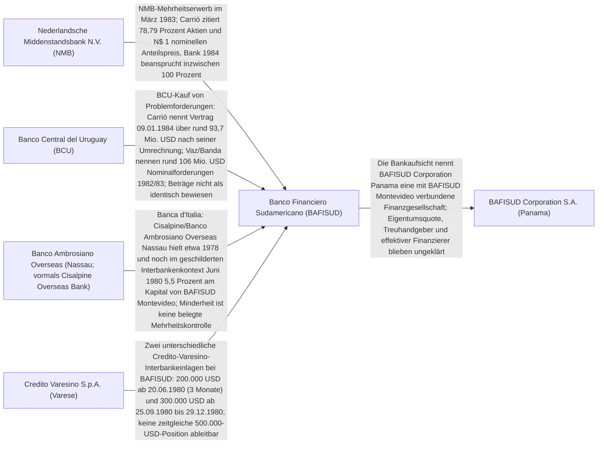

# BAFISUD – direkte Beziehungen

**5 quellengebundene Beziehungen** mit BAFISUD als Ausgangs- oder Zielakteur. Die Ansicht zeigt **nur unmittelbare Relationen**; sie beweist weder gemeinsame Steuerung noch Beziehungen zwischen den übrigen dargestellten Akteuren.

[Alle Fokusansichten](network-graph.md) · [Vollständige Relationstabelle](network.md)

## Quellen und Evidenz

| Relation | Richtung und anderer Akteur | Befund | Evidenz | Quellen |
|---|---|---|---|---|
| [REL-UY-PA-BAFISUD-1978-001](network.md#rel-uy-pa-bafisud-1978-001) | → BAFISUD Corporation S.A. (Panama) | Die Bankaufsicht nennt BAFISUD Corporation Panama eine mit BAFISUD Montevideo verbundene Finanzgesellschaft; Eigentumsquote, Treuhandgeber und effektiver Finanzierer blieben ungeklärt | stark gestützt | [SRC-IT-BANCA-ITALIA-BAFISUD-VARESINO-1983](../quellen/index.md#src-it-banca-italia-bafisud-varesino-1983) |
| [REL-BS-UY-BAFISUD-1978-001](network.md#rel-bs-uy-bafisud-1978-001) | ← Banco Ambrosiano Overseas (Nassau; vormals Cisalpine Overseas Bank) | Banca d'Italia: Cisalpine/Banco Ambrosiano Overseas Nassau hielt etwa 1978 und noch im geschilderten Interbankenkontext Juni 1980 5,5 Prozent am Kapital von BAFISUD Montevideo; Minderheit ist keine belegte Mehrheitskontrolle | belegt | [SRC-IT-BANCA-ITALIA-BAFISUD-VARESINO-1983](../quellen/index.md#src-it-banca-italia-bafisud-varesino-1983) |
| [REL-UY-BAFISUD-BCU-1984-001](network.md#rel-uy-bafisud-bcu-1984-001) | ← Banco Central del Uruguay (BCU) | BCU-Kauf von Problemforderungen: Carrió nennt Vertrag 09.01.1984 über rund 93,7 Mio. USD nach seiner Umrechnung; Vaz/Banda nennen rund 106 Mio. USD Nominalforderungen 1982/83; Beträge nicht als identisch bewiesen | stark gestützt | [SRC-UY-CARRIO-PAIS-VACIADO-1987-BAFISUD](../quellen/index.md#src-uy-carrio-pais-vaciado-1987-bafisud), [SRC-UY-BCU-VAZ-NPL-1999-TAB38](../quellen/index.md#src-uy-bcu-vaz-npl-1999-tab38), [SRC-UY-COPAB-BANKCRISIS-REPORT-2025](../quellen/index.md#src-uy-copab-bankcrisis-report-2025) |
| [REL-IT-UY-INTERBANK-DEPOSITS-1980-001](network.md#rel-it-uy-interbank-deposits-1980-001) | ← Credito Varesino S.p.A. (Varese) | Zwei unterschiedliche Credito-Varesino-Interbankeinlagen bei BAFISUD: 200.000 USD ab 20.06.1980 (3 Monate) und 300.000 USD ab 25.09.1980 bis 29.12.1980; keine zeitgleiche 500.000-USD-Position ableitbar | belegt | [SRC-IT-BANCA-ITALIA-BAFISUD-VARESINO-1983](../quellen/index.md#src-it-banca-italia-bafisud-varesino-1983) |
| [REL-UY-BAFISUD-NMB-1983-001](network.md#rel-uy-bafisud-nmb-1983-001) | ← Nederlandsche Middenstandsbank N.V. (NMB) | NMB-Mehrheitserwerb im März 1983; Carrió zitiert 78,79 Prozent Aktien und N$ 1 nominellen Anteilspreis, Bank 1984 beansprucht inzwischen 100 Prozent | stark gestützt | [SRC-UY-CARRIO-PAIS-VACIADO-1987-BAFISUD](../quellen/index.md#src-uy-carrio-pais-vaciado-1987-bafisud), [SRC-UY-CONVICCION-BAFISUD-REPLY-1984](../quellen/index.md#src-uy-conviccion-bafisud-reply-1984) |
