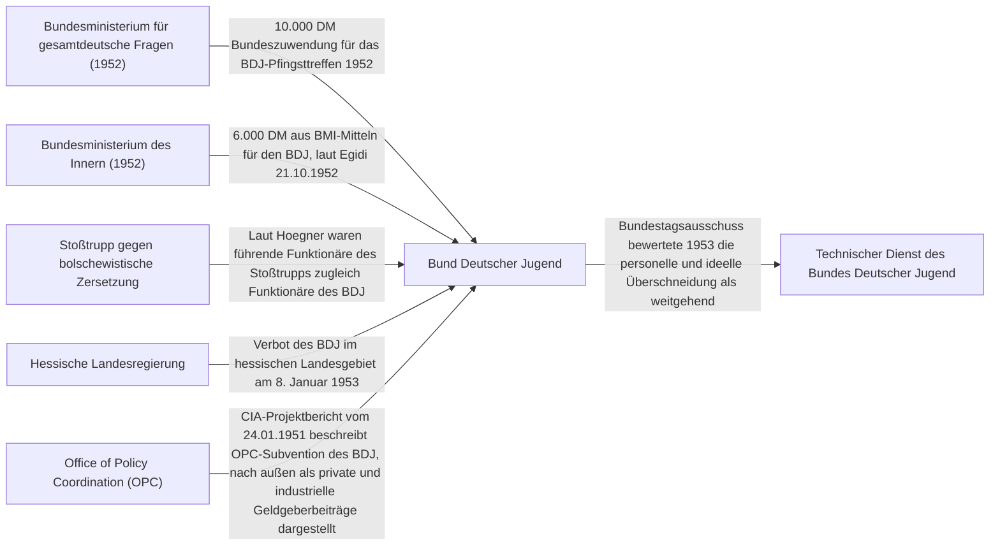

# Bund Deutscher Jugend – direkte Beziehungen

**6 quellengebundene Beziehungen** mit Bund Deutscher Jugend als Ausgangs- oder Zielakteur. Die Ansicht zeigt **nur unmittelbare Relationen**; sie beweist weder gemeinsame Steuerung noch Beziehungen zwischen den übrigen dargestellten Akteuren.

[Alle Fokusansichten](network-graph.md) · [Vollständige Relationstabelle](network.md)

## Quellen und Evidenz

| Relation | Richtung und anderer Akteur | Befund | Evidenz | Quellen |
|---|---|---|---|---|
| [REL-DE-BDJ-003](network.md#rel-de-bdj-003) | ← Bundesministerium des Innern (1952) | 6.000 DM aus BMI-Mitteln für den BDJ, laut Egidi 21.10.1952 | belegt | [SRC-DE-FRAK-BDJ-19521021](../quellen/index.md#src-de-frak-bdj-19521021) |
| [REL-DE-BDJ-002](network.md#rel-de-bdj-002) | ← Bundesministerium für gesamtdeutsche Fragen (1952) | 10.000 DM Bundeszuwendung für das BDJ-Pfingsttreffen 1952 | belegt | [SRC-DE-FRAK-BDJ-19521021](../quellen/index.md#src-de-frak-bdj-19521021), [SRC-DE-BARCH-KAB-BDJ-19521010](../quellen/index.md#src-de-barch-kab-bdj-19521010), [SRC-DE-BT-BDJ-19521023](../quellen/index.md#src-de-bt-bdj-19521023) |
| [REL-DE-BDJ-009](network.md#rel-de-bdj-009) | ← Hessische Landesregierung | Verbot des BDJ im hessischen Landesgebiet am 8. Januar 1953 | stark gestützt | [SRC-DE-HE-LAGIS-BDJ-19530108](../quellen/index.md#src-de-he-lagis-bdj-19530108) |
| [REL-DE-BDJ-015](network.md#rel-de-bdj-015) | ← Office of Policy Coordination (OPC) | CIA-Projektbericht vom 24.01.1951 beschreibt OPC-Subvention des BDJ, nach außen als private und industrielle Geldgeberbeiträge dargestellt | belegt | [SRC-US-CIA-LCPROWL-V1-0044](../quellen/index.md#src-us-cia-lcprowl-v1-0044) |
| [REL-DE-BDJ-007](network.md#rel-de-bdj-007) | ← Stoßtrupp gegen bolschewistische Zersetzung | Laut Hoegner waren führende Funktionäre des Stoßtrupps zugleich Funktionäre des BDJ | belegt | [SRC-DE-BYLT-TD-19521029](../quellen/index.md#src-de-bylt-td-19521029) |
| [REL-DE-BDJ-001](network.md#rel-de-bdj-001) | → Technischer Dienst des Bundes Deutscher Jugend | Bundestagsausschuss bewertete 1953 die personelle und ideelle Überschneidung als weitgehend | belegt | [SRC-DE-BT-04644-1953](../quellen/index.md#src-de-bt-04644-1953) |
