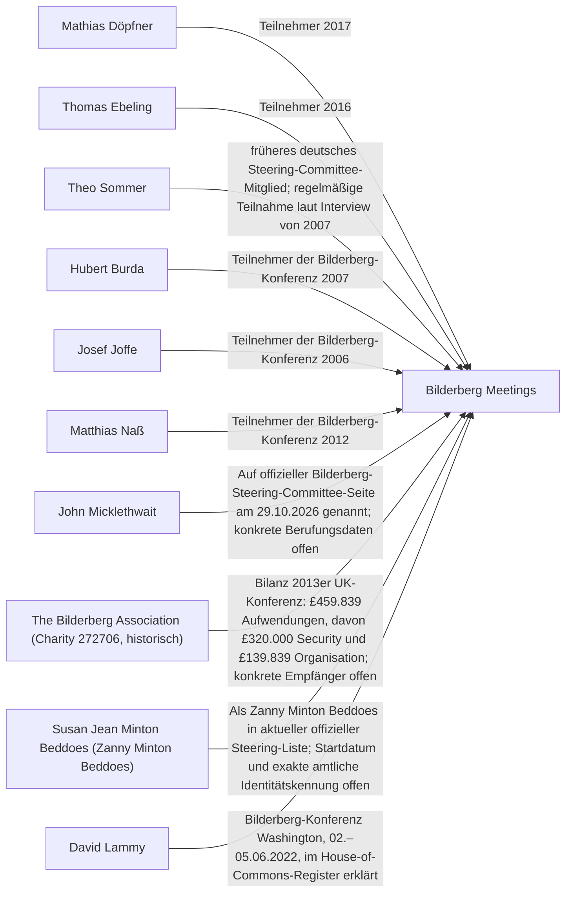

# Bilderberg Meetings – direkte Beziehungen

**10 quellengebundene Beziehungen** mit Bilderberg Meetings als Ausgangs- oder Zielakteur. Die Ansicht zeigt **nur unmittelbare Relationen**; sie beweist weder gemeinsame Steuerung noch Beziehungen zwischen den übrigen dargestellten Akteuren.

[Alle Fokusansichten](network-graph.md) · [Vollständige Relationstabelle](network.md)

## Quellen und Evidenz

| Relation | Richtung und anderer Akteur | Befund | Evidenz | Quellen |
|---|---|---|---|---|
| [REL-GB-BB-UK-010](network.md#rel-gb-bb-uk-010) | ← David Lammy | Bilderberg-Konferenz Washington, 02.–05.06.2022, im House-of-Commons-Register erklärt | belegt | [SRC-GB-COMMONS-LAMMY-RECTIFICATION-2022](../quellen/index.md#src-gb-commons-lammy-rectification-2022) |
| [REL-DE-TMN-053](network.md#rel-de-tmn-053) | ← Hubert Burda | Teilnehmer der Bilderberg-Konferenz 2007 | stark gestützt | [SRC-INT-BILDERBERG-2007-ARCHIVE](../quellen/index.md#src-int-bilderberg-2007-archive) |
| [REL-US-BBF-008](network.md#rel-us-bbf-008) | ← John Micklethwait | Auf offizieller Bilderberg-Steering-Committee-Seite am 29.10.2026 genannt; konkrete Berufungsdaten offen | belegt | [SRC-INT-BILDERBERG-STEERING-2026](../quellen/index.md#src-int-bilderberg-steering-2026) |
| [REL-DE-TMN-054](network.md#rel-de-tmn-054) | ← Josef Joffe | Teilnehmer der Bilderberg-Konferenz 2006 | stark gestützt | [SRC-INT-BILDERBERG-2006-ARCHIVE](../quellen/index.md#src-int-bilderberg-2006-archive) |
| [REL-DE-TMN-001](network.md#rel-de-tmn-001) | ← Mathias Döpfner | Teilnehmer 2017 | belegt | [SRC-INT-BILDERBERG-2017](../quellen/index.md#src-int-bilderberg-2017) |
| [REL-DE-TMN-055](network.md#rel-de-tmn-055) | ← Matthias Naß | Teilnehmer der Bilderberg-Konferenz 2012 | stark gestützt | [SRC-INT-BILDERBERG-2012-ARCHIVE](../quellen/index.md#src-int-bilderberg-2012-archive) |
| [REL-GB-BB-UK-007](network.md#rel-gb-bb-uk-007) | ← Susan Jean Minton Beddoes (Zanny Minton Beddoes) | Als Zanny Minton Beddoes in aktueller offizieller Steering-Liste; Startdatum und exakte amtliche Identitätskennung offen | stark gestützt | [SRC-INT-BILDERBERG-STEERING-2026](../quellen/index.md#src-int-bilderberg-steering-2026), [SRC-GB-COMPANIES-HOUSE-BILDERBERG-12988319](../quellen/index.md#src-gb-companies-house-bilderberg-12988319) |
| [REL-GB-BB-UK-001](network.md#rel-gb-bb-uk-001) | ← The Bilderberg Association (Charity 272706, historisch) | Bilanz 2013er UK-Konferenz: £459.839 Aufwendungen, davon £320.000 Security und £139.839 Organisation; konkrete Empfänger offen | stark gestützt | [SRC-GB-BILDERBERG-CHARITY-ACCOUNTS-2015](../quellen/index.md#src-gb-bilderberg-charity-accounts-2015) |
| [REL-DE-TMN-052](network.md#rel-de-tmn-052) | ← Theo Sommer | früheres deutsches Steering-Committee-Mitglied; regelmäßige Teilnahme laut Interview von 2007 | stark gestützt | [SRC-INT-BILDERBERG-FORMER-STEERING](../quellen/index.md#src-int-bilderberg-former-steering), [SRC-DE-MESSAGE-SOMMER-BILDERBERG-2007](../quellen/index.md#src-de-message-sommer-bilderberg-2007) |
| [REL-DE-TMN-051](network.md#rel-de-tmn-051) | ← Thomas Ebeling | Teilnehmer 2016 | stark gestützt | [SRC-INT-BILDERBERG-2016-ARCHIVE](../quellen/index.md#src-int-bilderberg-2016-archive) |
