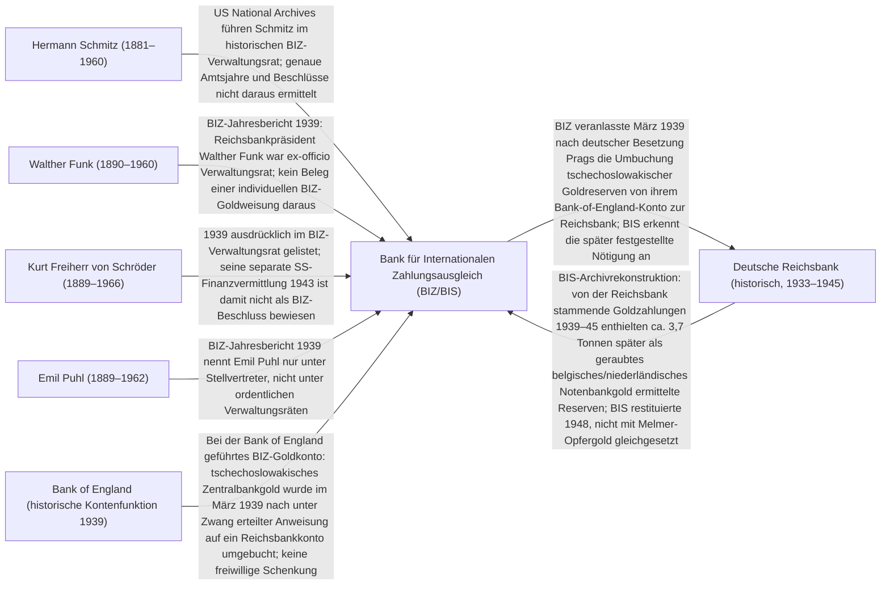

# BIZ / BIS – direkte Beziehungen

**7 quellengebundene Beziehungen** mit BIZ / BIS als Ausgangs- oder Zielakteur. Die Ansicht zeigt **nur unmittelbare Relationen**; sie beweist weder gemeinsame Steuerung noch Beziehungen zwischen den übrigen dargestellten Akteuren.

[Alle Fokusansichten](network-graph.md) · [Vollständige Relationstabelle](network.md)

## Quellen und Evidenz

| Relation | Richtung und anderer Akteur | Befund | Evidenz | Quellen |
|---|---|---|---|---|
| [REL-GB-BIS-GOLD-1939-001](network.md#rel-gb-bis-gold-1939-001) | ← Bank of England (historische Kontenfunktion 1939) | Bei der Bank of England geführtes BIZ-Goldkonto: tschechoslowakisches Zentralbankgold wurde im März 1939 nach unter Zwang erteilter Anweisung auf ein Reichsbankkonto umgebucht; keine freiwillige Schenkung | stark gestützt | [SRC-INT-BIS-HISTORY-1939-GOLD](../quellen/index.md#src-int-bis-history-1939-gold) |
| [REL-DE-BIS-GOLD-1945-001](network.md#rel-de-bis-gold-1945-001) | ← Deutsche Reichsbank (historisch, 1933–1945) | BIS-Archivrekonstruktion: von der Reichsbank stammende Goldzahlungen 1939–45 enthielten ca. 3,7 Tonnen später als geraubtes belgisches/niederländisches Notenbankgold ermittelte Reserven; BIS restituierte 1948, nicht mit Melmer-Opfergold gleichgesetzt | stark gestützt | [SRC-INT-BIS-HISTORY-1939-GOLD](../quellen/index.md#src-int-bis-history-1939-gold) |
| [REL-INT-BIS-GOLD-1939-001](network.md#rel-int-bis-gold-1939-001) | → Deutsche Reichsbank (historisch, 1933–1945) | BIZ veranlasste März 1939 nach deutscher Besetzung Prags die Umbuchung tschechoslowakischer Goldreserven von ihrem Bank-of-England-Konto zur Reichsbank; BIS erkennt die später festgestellte Nötigung an | stark gestützt | [SRC-INT-BIS-HISTORY-1939-GOLD](../quellen/index.md#src-int-bis-history-1939-gold) |
| [REL-INT-BIS-1939-003](network.md#rel-int-bis-1939-003) | ← Emil Puhl (1889–1962) | BIZ-Jahresbericht 1939 nennt Emil Puhl nur unter Stellvertreter, nicht unter ordentlichen Verwaltungsräten | belegt | [SRC-INT-BIS-ANNUAL-REPORT-1939](../quellen/index.md#src-int-bis-annual-report-1939) |
| [REL-INT-IGF-010](network.md#rel-int-igf-010) | ← Hermann Schmitz (1881–1960) | US National Archives führen Schmitz im historischen BIZ-Verwaltungsrat; genaue Amtsjahre und Beschlüsse nicht daraus ermittelt | stark gestützt | [SRC-US-NARA-BIS-WARTIME-FOOTNOTE](../quellen/index.md#src-us-nara-bis-wartime-footnote) |
| [REL-INT-BIS-1939-002](network.md#rel-int-bis-1939-002) | ← Kurt Freiherr von Schröder (1889–1966) | 1939 ausdrücklich im BIZ-Verwaltungsrat gelistet; seine separate SS-Finanzvermittlung 1943 ist damit nicht als BIZ-Beschluss bewiesen | belegt | [SRC-INT-BIS-ANNUAL-REPORT-1939](../quellen/index.md#src-int-bis-annual-report-1939) |
| [REL-INT-BIS-1939-001](network.md#rel-int-bis-1939-001) | ← Walther Funk (1890–1960) | BIZ-Jahresbericht 1939: Reichsbankpräsident Walther Funk war ex-officio Verwaltungsrat; kein Beleg einer individuellen BIZ-Goldweisung daraus | belegt | [SRC-INT-BIS-ANNUAL-REPORT-1939](../quellen/index.md#src-int-bis-annual-report-1939) |
