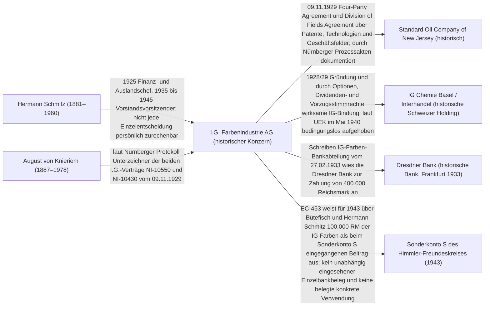

# I.G. Farben – direkte Beziehungen

**6 quellengebundene Beziehungen** mit I.G. Farben als Ausgangs- oder Zielakteur. Die Ansicht zeigt **nur unmittelbare Relationen**; sie beweist weder gemeinsame Steuerung noch Beziehungen zwischen den übrigen dargestellten Akteuren.

[Alle Fokusansichten](network-graph.md) · [Vollständige Relationstabelle](network.md)

## Quellen und Evidenz

| Relation | Richtung und anderer Akteur | Befund | Evidenz | Quellen |
|---|---|---|---|---|
| [REL-DE-IGF-002](network.md#rel-de-igf-002) | ← August von Knieriem (1887–1978) | laut Nürnberger Protokoll Unterzeichner der beiden I.G.-Verträge NI-10550 und NI-10430 vom 09.11.1929 | stark gestützt | [SRC-US-NMT-IGFARBEN-STANDARD-19471017](../quellen/index.md#src-us-nmt-igfarben-standard-19471017) |
| [REL-DE-IGF-011](network.md#rel-de-igf-011) | → Dresdner Bank (historische Bank, Frankfurt 1933) | Schreiben IG-Farben-Bankabteilung vom 27.02.1933 wies die Dresdner Bank zur Zahlung von 400.000 Reichsmark an | belegt | [SRC-US-NMT-IGFARBEN-FUND-NI391-19470902](../quellen/index.md#src-us-nmt-igfarben-fund-ni391-19470902) |
| [REL-DE-IGF-001](network.md#rel-de-igf-001) | ← Hermann Schmitz (1881–1960) | 1925 Finanz- und Auslandschef, 1935 bis 1945 Vorstandsvorsitzender; nicht jede Einzelentscheidung persönlich zurechenbar | stark gestützt | [SRC-DE-NDB-HERMANN-SCHMITZ](../quellen/index.md#src-de-ndb-hermann-schmitz) |
| [REL-CH-IGF-006](network.md#rel-ch-igf-006) | → IG Chemie Basel / Interhandel (historische Schweizer Holding) | 1928/29 Gründung und durch Optionen, Dividenden- und Vorzugsstimmrechte wirksame IG-Bindung; laut UEK im Mai 1940 bedingungslos aufgehoben | stark gestützt | [SRC-CH-UEK-INTERHANDEL-KOENIG](../quellen/index.md#src-ch-uek-interhandel-koenig) |
| [REL-DE-SS-FUND-1943-002](network.md#rel-de-ss-fund-1943-002) | → Sonderkonto S des Himmler-Freundeskreises (1943) | EC-453 weist für 1943 über Bütefisch und Hermann Schmitz 100.000 RM der IG Farben als beim Sonderkonto S eingegangenen Beitrag aus; kein unabhängig eingesehener Einzelbankbeleg und keine belegte konkrete Verwendung | stark gestützt | [SRC-US-IMT-EC453-SCHROEDER-HIMMLER-1943](../quellen/index.md#src-us-imt-ec453-schroeder-himmler-1943) |
| [REL-DE-IGF-003](network.md#rel-de-igf-003) | → Standard Oil Company of New Jersey (historisch) | 09.11.1929 Four-Party Agreement und Division of Fields Agreement über Patente, Technologien und Geschäftsfelder; durch Nürnberger Prozessakten dokumentiert | belegt | [SRC-US-NMT-IGFARBEN-STANDARD-19471017](../quellen/index.md#src-us-nmt-igfarben-standard-19471017) |
