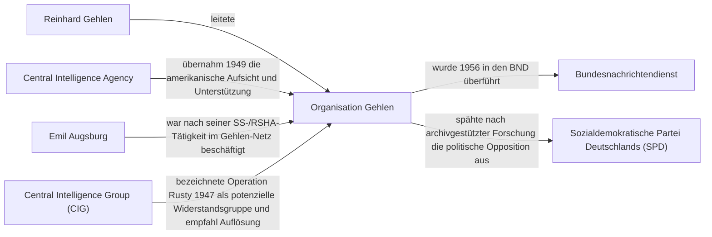

# Organisation Gehlen – direkte Beziehungen

**6 quellengebundene Beziehungen** mit Organisation Gehlen als Ausgangs- oder Zielakteur. Die Ansicht zeigt **nur unmittelbare Relationen**; sie beweist weder gemeinsame Steuerung noch Beziehungen zwischen den übrigen dargestellten Akteuren.

[Alle Fokusansichten](network-graph.md) · [Vollständige Relationstabelle](network.md)

## Quellen und Evidenz

| Relation | Richtung und anderer Akteur | Befund | Evidenz | Quellen |
|---|---|---|---|---|
| [REL-DE-GEHLEN-001](network.md#rel-de-gehlen-001) | → Bundesnachrichtendienst | wurde 1956 in den BND überführt | stark gestützt | [SRC-DE-BPB-BND-2026](../quellen/index.md#src-de-bpb-bnd-2026) |
| [REL-DE-GEHLEN-004](network.md#rel-de-gehlen-004) | ← Central Intelligence Agency | übernahm 1949 die amerikanische Aufsicht und Unterstützung | stark gestützt | [SRC-DE-BPB-BND-2026](../quellen/index.md#src-de-bpb-bnd-2026), [SRC-US-NSA-GEHLEN-2005](../quellen/index.md#src-us-nsa-gehlen-2005) |
| [REL-DE-GEHLEN-008](network.md#rel-de-gehlen-008) | ← Central Intelligence Group (CIG) | bezeichnete Operation Rusty 1947 als potenzielle Widerstandsgruppe und empfahl Auflösung | belegt | [SRC-US-CIG-RUSTY-DOC45-19470606](../quellen/index.md#src-us-cig-rusty-doc45-19470606) |
| [REL-DE-GEHLEN-005](network.md#rel-de-gehlen-005) | ← Emil Augsburg | war nach seiner SS-/RSHA-Tätigkeit im Gehlen-Netz beschäftigt | stark gestützt | [SRC-US-NARA-IWG-GEHLEN-2001](../quellen/index.md#src-us-nara-iwg-gehlen-2001) |
| [REL-DE-GEHLEN-002](network.md#rel-de-gehlen-002) | ← Reinhard Gehlen | leitete | stark gestützt | [SRC-DE-BPB-BND-2026](../quellen/index.md#src-de-bpb-bnd-2026) |
| [REL-DE-GEHLEN-007](network.md#rel-de-gehlen-007) | → Sozialdemokratische Partei Deutschlands (SPD) | spähte nach archivgestützter Forschung die politische Opposition aus | stark gestützt | [SRC-DE-BPB-HENKE-INLAND-2014](../quellen/index.md#src-de-bpb-henke-inland-2014), [SRC-DE-BPB-HENKE-GEHEIME-2019](../quellen/index.md#src-de-bpb-henke-geheime-2019) |
