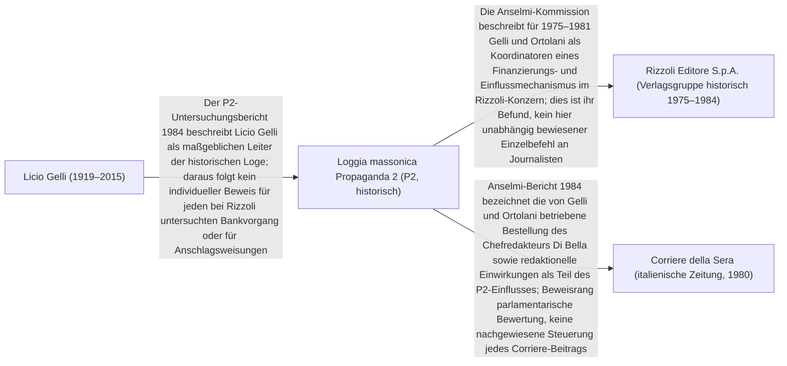

# P2 / Loge – direkte Beziehungen

**3 quellengebundene Beziehungen** mit P2 / Loge als Ausgangs- oder Zielakteur. Die Ansicht zeigt **nur unmittelbare Relationen**; sie beweist weder gemeinsame Steuerung noch Beziehungen zwischen den übrigen dargestellten Akteuren.

[Alle Fokusansichten](network-graph.md) · [Vollständige Relationstabelle](network.md)

## Quellen und Evidenz

| Relation | Richtung und anderer Akteur | Befund | Evidenz | Quellen |
|---|---|---|---|---|
| [REL-IT-P2-RIZZOLI-EDITORIAL-1980-001](network.md#rel-it-p2-rizzoli-editorial-1980-001) | → Corriere della Sera (italienische Zeitung, 1980) | Anselmi-Bericht 1984 bezeichnet die von Gelli und Ortolani betriebene Bestellung des Chefredakteurs Di Bella sowie redaktionelle Einwirkungen als Teil des P2-Einflusses; Beweisrang parlamentarische Bewertung, keine nachgewiesene Steuerung jedes Corriere-Beitrags | stark gestützt | [SRC-IT-P2-ANSELMI-REPORT-1984](../quellen/index.md#src-it-p2-anselmi-report-1984) |
| [REL-IT-P2-GELLI-1981-001](network.md#rel-it-p2-gelli-1981-001) | ← Licio Gelli (1919–2015) | Der P2-Untersuchungsbericht 1984 beschreibt Licio Gelli als maßgeblichen Leiter der historischen Loge; daraus folgt kein individueller Beweis für jeden bei Rizzoli untersuchten Bankvorgang oder für Anschlagsweisungen | stark gestützt | [SRC-IT-P2-ANSELMI-REPORT-1984](../quellen/index.md#src-it-p2-anselmi-report-1984) |
| [REL-IT-P2-RIZZOLI-1975-1981-001](network.md#rel-it-p2-rizzoli-1975-1981-001) | → Rizzoli Editore S.p.A. (Verlagsgruppe historisch 1975–1984) | Die Anselmi-Kommission beschreibt für 1975–1981 Gelli und Ortolani als Koordinatoren eines Finanzierungs- und Einflussmechanismus im Rizzoli-Konzern; dies ist ihr Befund, kein hier unabhängig bewiesener Einzelbefehl an Journalisten | stark gestützt | [SRC-IT-P2-ANSELMI-REPORT-1984](../quellen/index.md#src-it-p2-anselmi-report-1984) |
