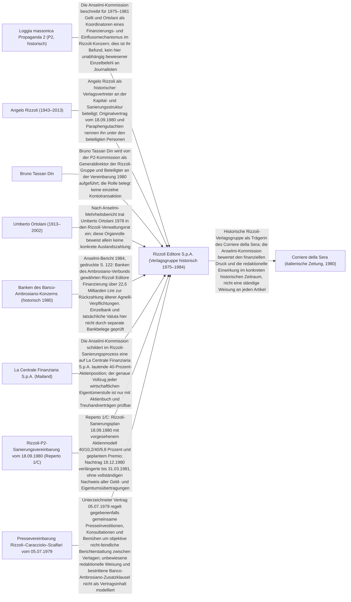

# Rizzoli / Corriere – direkte Beziehungen

**9 quellengebundene Beziehungen** mit Rizzoli / Corriere als Ausgangs- oder Zielakteur. Die Ansicht zeigt **nur unmittelbare Relationen**; sie beweist weder gemeinsame Steuerung noch Beziehungen zwischen den übrigen dargestellten Akteuren.

[Alle Fokusansichten](network-graph.md) · [Vollständige Relationstabelle](network.md)

## Quellen und Evidenz

| Relation | Richtung und anderer Akteur | Befund | Evidenz | Quellen |
|---|---|---|---|---|
| [REL-IT-RIZZOLI-ANGELO-1980-001](network.md#rel-it-rizzoli-angelo-1980-001) | ← Angelo Rizzoli (1943–2013) | Angelo Rizzoli als historischer Verlagsvertreter an der Kapital- und Sanierungsstruktur beteiligt; Originalvertrag vom 18.09.1980 und Paraphengutachten nennen ihn unter den beteiligten Personen | stark gestützt | [SRC-IT-P2-ANSELMI-REPORT-1984](../quellen/index.md#src-it-p2-anselmi-report-1984), [SRC-IT-P2-RIZZOLI-AGREEMENT-1980-ORIGINAL](../quellen/index.md#src-it-p2-rizzoli-agreement-1980-original) |
| [REL-IT-AMBROSIANO-RIZZOLI-1980-001](network.md#rel-it-ambrosiano-rizzoli-1980-001) | ← Banken des Banco-Ambrosiano-Konzerns (historisch 1980) | Anselmi-Bericht 1984, gedruckte S. 122: Banken des Ambrosiano-Verbunds gewährten Rizzoli Editore Finanzierung über 22,5 Milliarden Lire zur Rückzahlung älterer Agnelli-Verpflichtungen. Einzelbank und tatsächliche Valuta hier nicht durch separate Bankbelege geprüft | stark gestützt | [SRC-IT-P2-ANSELMI-REPORT-1984](../quellen/index.md#src-it-p2-anselmi-report-1984) |
| [REL-IT-RIZZOLI-TASSANDIN-1980-001](network.md#rel-it-rizzoli-tassandin-1980-001) | ← Bruno Tassan Din | Bruno Tassan Din wird von der P2-Kommission als Generaldirektor der Rizzoli-Gruppe und Beteiligter an der Vereinbarung 1980 aufgeführt; die Rolle belegt keine einzelne Kontotransaktion | stark gestützt | [SRC-IT-P2-ANSELMI-REPORT-1984](../quellen/index.md#src-it-p2-anselmi-report-1984) |
| [REL-IT-RIZZOLI-CORRIERE-1977-001](network.md#rel-it-rizzoli-corriere-1977-001) | → Corriere della Sera (italienische Zeitung, 1980) | Historische Rizzoli-Verlagsgruppe als Trägerin des Corriere della Sera; die Anselmi-Kommission bewertet den finanziellen Druck und die redaktionelle Einwirkung im konkreten historischen Zeitraum, nicht eine ständige Weisung an jeden Artikel | stark gestützt | [SRC-IT-P2-ANSELMI-REPORT-1984](../quellen/index.md#src-it-p2-anselmi-report-1984) |
| [REL-IT-LACENTRALE-RIZZOLI-1981-001](network.md#rel-it-lacentrale-rizzoli-1981-001) | ← La Centrale Finanziaria S.p.A. (Mailand) | Die Anselmi-Kommission schildert im Rizzoli-Sanierungsprozess eine auf La Centrale Finanziaria S.p.A. lautende 40-Prozent-Aktienposition; der genaue Vollzug jeder wirtschaftlichen Eigentümerstufe ist nur mit Aktienbuch und Treuhandverträgen prüfbar | stark gestützt | [SRC-IT-P2-ANSELMI-REPORT-1984](../quellen/index.md#src-it-p2-anselmi-report-1984) |
| [REL-IT-P2-RIZZOLI-1975-1981-001](network.md#rel-it-p2-rizzoli-1975-1981-001) | ← Loggia massonica Propaganda 2 (P2, historisch) | Die Anselmi-Kommission beschreibt für 1975–1981 Gelli und Ortolani als Koordinatoren eines Finanzierungs- und Einflussmechanismus im Rizzoli-Konzern; dies ist ihr Befund, kein hier unabhängig bewiesener Einzelbefehl an Journalisten | stark gestützt | [SRC-IT-P2-ANSELMI-REPORT-1984](../quellen/index.md#src-it-p2-anselmi-report-1984) |
| [REL-IT-P2-PRESSPACT-PUBLISHER-1979-001](network.md#rel-it-p2-presspact-publisher-1979-001) | ← Pressevereinbarung Rizzoli–Caracciolo–Scalfari vom 05.07.1979 | Unterzeichneter Vertrag 05.07.1979 regelt gegebenenfalls gemeinsame Presseinvestitionen, Konsultationen und Bemühen um objektive nicht-feindliche Berichterstattung zwischen Verlagen; unbewiesene redaktionelle Weisung und bestrittene Banco-Ambrosiano-Zusatzklausel nicht als Vertragsinhalt modelliert | belegt | [SRC-IT-P2-RIZZOLI-CARACCIOLO-PRESS-PACT-1979](../quellen/index.md#src-it-p2-rizzoli-caracciolo-press-pact-1979) |
| [REL-IT-P2-AGREEMENT-RIZZOLI-CORP-1980-001](network.md#rel-it-p2-agreement-rizzoli-corp-1980-001) | ← Rizzoli-P2-Sanierungsvereinbarung vom 18.09.1980 (Reperto 1/C) | Reperto 1/C: Rizzoli-Sanierungsplan 18.09.1980 mit vorgesehenem Aktienmodell 40/10,2/40/9,8 Prozent und geplantem Premio; Nachtrag 18.12.1980 verlängerte bis 31.03.1981, ohne vollständigen Nachweis aller Geld- und Eigentumsübertragungen | stark gestützt | [SRC-IT-P2-RIZZOLI-AGREEMENT-1980-ORIGINAL](../quellen/index.md#src-it-p2-rizzoli-agreement-1980-original) |
| [REL-IT-RIZZOLI-ORTOLANI-1978-001](network.md#rel-it-rizzoli-ortolani-1978-001) | ← Umberto Ortolani (1913–2002) | Nach Anselmi-Mehrheitsbericht trat Umberto Ortolani 1978 in den Rizzoli-Verwaltungsrat ein; diese Organrolle beweist allein keine konkrete Auslandszahlung | stark gestützt | [SRC-IT-P2-ANSELMI-REPORT-1984](../quellen/index.md#src-it-p2-anselmi-report-1984) |
