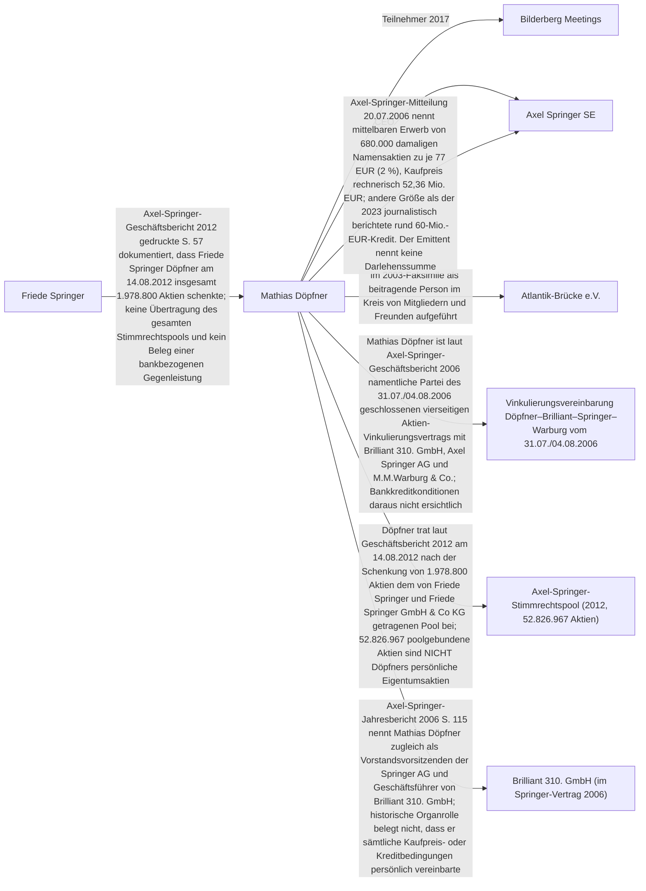

# Döpfner / Springer – direkte Beziehungen

**8 quellengebundene Beziehungen** mit Döpfner / Springer als Ausgangs- oder Zielakteur. Die Ansicht zeigt **nur unmittelbare Relationen**; sie beweist weder gemeinsame Steuerung noch Beziehungen zwischen den übrigen dargestellten Akteuren.

[Alle Fokusansichten](network-graph.md) · [Vollständige Relationstabelle](network.md)

## Quellen und Evidenz

| Relation | Richtung und anderer Akteur | Befund | Evidenz | Quellen |
|---|---|---|---|---|
| [REL-DE-TMN-036](network.md#rel-de-tmn-036) | → Atlantik-Brücke e.V. | im 2003-Faksimile als beitragende Person im Kreis von Mitgliedern und Freunden aufgeführt | stark gestützt | [SRC-DE-AB-MESSAGE-2003-MIRROR](../quellen/index.md#src-de-ab-message-2003-mirror) |
| [REL-DE-SPRINGER-DOEPFNER-EQUITY-2006-001](network.md#rel-de-springer-doepfner-equity-2006-001) | → Axel Springer SE | Axel-Springer-Mitteilung 20.07.2006 nennt mittelbaren Erwerb von 680.000 damaligen Namensaktien zu je 77 EUR (2 %), Kaufpreis rechnerisch 52,36 Mio. EUR; andere Größe als der 2023 journalistisch berichtete rund 60-Mio.-EUR-Kredit. Der Emittent nennt keine Darlehenssumme | stark gestützt | [SRC-DE-AXELSPRINGER-PR-20060720](../quellen/index.md#src-de-axelspringer-pr-20060720) |
| [REL-DE-TMN-002](network.md#rel-de-tmn-002) | → Axel Springer SE | CEO | belegt | [SRC-INT-BILDERBERG-2017](../quellen/index.md#src-int-bilderberg-2017) |
| [REL-DE-DOEPFNER-SPRINGER-POOL-2012-001](network.md#rel-de-doepfner-springer-pool-2012-001) | → Axel-Springer-Stimmrechtspool (2012, 52.826.967 Aktien) | Döpfner trat laut Geschäftsbericht 2012 am 14.08.2012 nach der Schenkung von 1.978.800 Aktien dem von Friede Springer und Friede Springer GmbH & Co KG getragenen Pool bei; 52.826.967 poolgebundene Aktien sind NICHT Döpfners persönliche Eigentumsaktien | belegt | [SRC-DE-AXELSPRINGER-GB-2012-POOL](../quellen/index.md#src-de-axelspringer-gb-2012-pool) |
| [REL-DE-TMN-001](network.md#rel-de-tmn-001) | → Bilderberg Meetings | Teilnehmer 2017 | belegt | [SRC-INT-BILDERBERG-2017](../quellen/index.md#src-int-bilderberg-2017) |
| [REL-DE-DOEPFNER-BRILLIANT-MANAGEMENT-2006-001](network.md#rel-de-doepfner-brilliant-management-2006-001) | → Brilliant 310. GmbH (im Springer-Vertrag 2006) | Axel-Springer-Jahresbericht 2006 S. 115 nennt Mathias Döpfner zugleich als Vorstandsvorsitzenden der Springer AG und Geschäftsführer von Brilliant 310. GmbH; historische Organrolle belegt nicht, dass er sämtliche Kaufpreis- oder Kreditbedingungen persönlich vereinbarte | belegt | [SRC-DE-AXELSPRINGER-GB-2006-WARBURG-VINK](../quellen/index.md#src-de-axelspringer-gb-2006-warburg-vink) |
| [REL-DE-FRIEDE-DOEPFNER-GIFT-2012-001](network.md#rel-de-friede-doepfner-gift-2012-001) | ← Friede Springer | Axel-Springer-Geschäftsbericht 2012 gedruckte S. 57 dokumentiert, dass Friede Springer Döpfner am 14.08.2012 insgesamt 1.978.800 Aktien schenkte; keine Übertragung des gesamten Stimmrechtspools und kein Beleg einer bankbezogenen Gegenleistung | belegt | [SRC-DE-AXELSPRINGER-GB-2012-POOL](../quellen/index.md#src-de-axelspringer-gb-2012-pool) |
| [REL-DE-DOEPFNER-SPRINGER-VINK-2006-001](network.md#rel-de-doepfner-springer-vink-2006-001) | → Vinkulierungsvereinbarung Döpfner–Brilliant–Springer–Warburg vom 31.07./04.08.2006 | Mathias Döpfner ist laut Axel-Springer-Geschäftsbericht 2006 namentliche Partei des 31.07./04.08.2006 geschlossenen vierseitigen Aktien-Vinkulierungsvertrags mit Brilliant 310. GmbH, Axel Springer AG und M.M.Warburg & Co.; Bankkreditkonditionen daraus nicht ersichtlich | belegt | [SRC-DE-AXELSPRINGER-GB-2006-WARBURG-VINK](../quellen/index.md#src-de-axelspringer-gb-2006-warburg-vink) |
