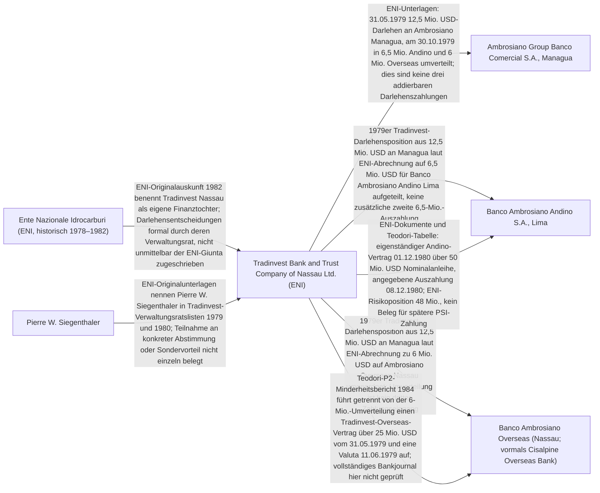

# ENI / Tradinvest – direkte Beziehungen

**7 quellengebundene Beziehungen** mit ENI / Tradinvest als Ausgangs- oder Zielakteur. Die Ansicht zeigt **nur unmittelbare Relationen**; sie beweist weder gemeinsame Steuerung noch Beziehungen zwischen den übrigen dargestellten Akteuren.

[Alle Fokusansichten](network-graph.md) · [Vollständige Relationstabelle](network.md)

## Quellen und Evidenz

| Relation | Richtung und anderer Akteur | Befund | Evidenz | Quellen |
|---|---|---|---|---|
| [REL-BS-NI-TRAD-1979-001](network.md#rel-bs-ni-trad-1979-001) | → Ambrosiano Group Banco Comercial S.A., Managua | ENI-Unterlagen: 31.05.1979 12,5 Mio. USD-Darlehen an Ambrosiano Managua, am 30.10.1979 in 6,5 Mio. Andino und 6 Mio. Overseas umverteilt; dies sind keine drei addierbaren Darlehenszahlungen | belegt | [SRC-IT-P2-ENI-TRADINVEST-1982](../quellen/index.md#src-it-p2-eni-tradinvest-1982), [SRC-IT-P2-TEODORI-ENI-SUDAM-1984](../quellen/index.md#src-it-p2-teodori-eni-sudam-1984) |
| [REL-BS-PE-TRAD-1979-001](network.md#rel-bs-pe-trad-1979-001) | → Banco Ambrosiano Andino S.A., Lima | 1979er Tradinvest-Darlehensposition aus 12,5 Mio. USD an Managua laut ENI-Abrechnung auf 6,5 Mio. USD für Banco Ambrosiano Andino Lima aufgeteilt, keine zusätzliche zweite 6,5-Mio.-Auszahlung | belegt | [SRC-IT-P2-ENI-TRADINVEST-1982](../quellen/index.md#src-it-p2-eni-tradinvest-1982), [SRC-IT-P2-TEODORI-ENI-SUDAM-1984](../quellen/index.md#src-it-p2-teodori-eni-sudam-1984) |
| [REL-BS-PE-TRAD-1980-001](network.md#rel-bs-pe-trad-1980-001) | → Banco Ambrosiano Andino S.A., Lima | ENI-Dokumente und Teodori-Tabelle: eigenständiger Andino-Vertrag 01.12.1980 über 50 Mio. USD Nominalanleihe, angegebene Auszahlung 08.12.1980; ENI-Risikoposition 48 Mio., kein Beleg für spätere PSI-Zahlung | belegt | [SRC-IT-P2-ENI-TRADINVEST-1982](../quellen/index.md#src-it-p2-eni-tradinvest-1982), [SRC-IT-P2-TEODORI-ENI-SUDAM-1984](../quellen/index.md#src-it-p2-teodori-eni-sudam-1984) |
| [REL-BS-BS-TRAD-1979-001](network.md#rel-bs-bs-trad-1979-001) | → Banco Ambrosiano Overseas (Nassau; vormals Cisalpine Overseas Bank) | 1979er Tradinvest-Darlehensposition aus 12,5 Mio. USD an Managua laut ENI-Abrechnung zu 6 Mio. USD auf Ambrosiano Overseas Nassau umgeordnet; Umverteilung ist kein dritter Zahlungseingang | belegt | [SRC-IT-P2-ENI-TRADINVEST-1982](../quellen/index.md#src-it-p2-eni-tradinvest-1982), [SRC-IT-P2-TEODORI-ENI-SUDAM-1984](../quellen/index.md#src-it-p2-teodori-eni-sudam-1984) |
| [REL-BS-BS-TRAD-1979-002](network.md#rel-bs-bs-trad-1979-002) | → Banco Ambrosiano Overseas (Nassau; vormals Cisalpine Overseas Bank) | Teodori-P2-Minderheitsbericht 1984 führt getrennt von der 6-Mio.-Umverteilung einen Tradinvest-Overseas-Vertrag über 25 Mio. USD vom 31.05.1979 und eine Valuta 11.06.1979 auf; vollständiges Bankjournal hier nicht geprüft | stark gestützt | [SRC-IT-P2-TEODORI-ENI-SUDAM-1984](../quellen/index.md#src-it-p2-teodori-eni-sudam-1984) |
| [REL-IT-ENI-TRAD-1979-001](network.md#rel-it-eni-trad-1979-001) | ← Ente Nazionale Idrocarburi (ENI, historisch 1978–1982) | ENI-Originalauskunft 1982 benennt Tradinvest Nassau als eigene Finanztochter; Darlehensentscheidungen formal durch deren Verwaltungsrat, nicht unmittelbar der ENI-Giunta zugeschrieben | belegt | [SRC-IT-P2-ENI-TRADINVEST-1982](../quellen/index.md#src-it-p2-eni-tradinvest-1982) |
| [REL-INT-TRAD-SIEG-1979-001](network.md#rel-int-trad-sieg-1979-001) | ← Pierre W. Siegenthaler | ENI-Originalunterlagen nennen Pierre W. Siegenthaler in Tradinvest-Verwaltungsratslisten 1979 und 1980; Teilnahme an konkreter Abstimmung oder Sondervorteil nicht einzeln belegt | belegt | [SRC-IT-P2-ENI-TRADINVEST-1982](../quellen/index.md#src-it-p2-eni-tradinvest-1982) |
