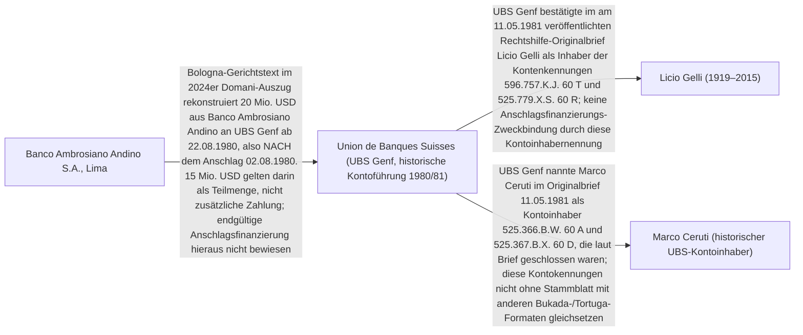

# UBS Genf / Bologna 1980 – direkte Beziehungen

**3 quellengebundene Beziehungen** mit UBS Genf / Bologna 1980 als Ausgangs- oder Zielakteur. Die Ansicht zeigt **nur unmittelbare Relationen**; sie beweist weder gemeinsame Steuerung noch Beziehungen zwischen den übrigen dargestellten Akteuren.

[Alle Fokusansichten](network-graph.md) · [Vollständige Relationstabelle](network.md)

## Quellen und Evidenz

| Relation | Richtung und anderer Akteur | Befund | Evidenz | Quellen |
|---|---|---|---|---|
| [REL-PE-CH-BOLOGNA-ANDINO-UBS-1980-001](network.md#rel-pe-ch-bologna-andino-ubs-1980-001) | ← Banco Ambrosiano Andino S.A., Lima | Bologna-Gerichtstext im 2024er Domani-Auszug rekonstruiert 20 Mio. USD aus Banco Ambrosiano Andino an UBS Genf ab 22.08.1980, also NACH dem Anschlag 02.08.1980. 15 Mio. USD gelten darin als Teilmenge, nicht zusätzliche Zahlung; endgültige Anschlagsfinanzierung hieraus nicht bewiesen | stark gestützt | [SRC-IT-BOLOGNA-DOMANI-COURT-EXCERPT-2024](../quellen/index.md#src-it-bologna-domani-court-excerpt-2024) |
| [REL-CH-UBS-GELLI-1981-001](network.md#rel-ch-ubs-gelli-1981-001) | → Licio Gelli (1919–2015) | UBS Genf bestätigte im am 11.05.1981 veröffentlichten Rechtshilfe-Originalbrief Licio Gelli als Inhaber der Kontenkennungen 596.757.K.J. 60 T und 525.779.X.S. 60 R; keine Anschlagsfinanzierungs-Zweckbindung durch diese Kontoinhabernennung | stark gestützt | [SRC-IT-P2-UBS-GELLI-CERUTI-19810511](../quellen/index.md#src-it-p2-ubs-gelli-ceruti-19810511) |
| [REL-CH-UBS-CERUTI-1981-001](network.md#rel-ch-ubs-ceruti-1981-001) | → Marco Ceruti (historischer UBS-Kontoinhaber) | UBS Genf nannte Marco Ceruti im Originalbrief 11.05.1981 als Kontoinhaber 525.366.B.W. 60 A und 525.367.B.X. 60 D, die laut Brief geschlossen waren; diese Kontokennungen nicht ohne Stammblatt mit anderen Bukada-/Tortuga-Formaten gleichsetzen | stark gestützt | [SRC-IT-P2-UBS-GELLI-CERUTI-19810511](../quellen/index.md#src-it-p2-ubs-gelli-ceruti-19810511) |
