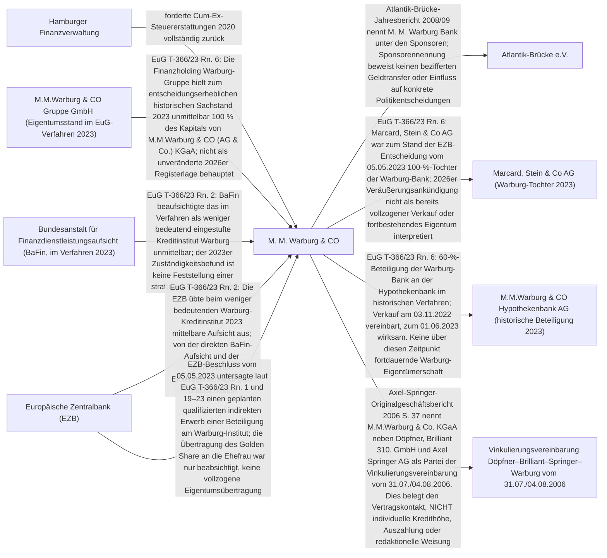

# M.M.Warburg / Eigentum & Aufsicht – direkte Beziehungen

**9 quellengebundene Beziehungen** mit M.M.Warburg / Eigentum & Aufsicht als Ausgangs- oder Zielakteur. Die Ansicht zeigt **nur unmittelbare Relationen**; sie beweist weder gemeinsame Steuerung noch Beziehungen zwischen den übrigen dargestellten Akteuren.

[Alle Fokusansichten](network-graph.md) · [Vollständige Relationstabelle](network.md)

## Quellen und Evidenz

| Relation | Richtung und anderer Akteur | Befund | Evidenz | Quellen |
|---|---|---|---|---|
| [REL-DE-AB-WARBURG-SPONSOR-2009-001](network.md#rel-de-ab-warburg-sponsor-2009-001) | → Atlantik-Brücke e.V. | Atlantik-Brücke-Jahresbericht 2008/09 nennt M. M. Warburg Bank unter den Sponsoren; Sponsorennennung beweist keinen bezifferten Geldtransfer oder Einfluss auf konkrete Politikentscheidungen | stark gestützt | [SRC-DE-AB-JB-2008-2009](../quellen/index.md#src-de-ab-jb-2008-2009) |
| [REL-DE-WARBURG-BAFIN-DIRECT-2023-001](network.md#rel-de-warburg-bafin-direct-2023-001) | ← Bundesanstalt für Finanzdienstleistungsaufsicht (BaFin, im Verfahren 2023) | EuG T-366/23 Rn. 2: BaFin beaufsichtigte das im Verfahren als weniger bedeutend eingestufte Kreditinstitut Warburg unmittelbar; der 2023er Zuständigkeitsbefund ist keine Feststellung einer strafbaren Gegenleistung | belegt | [SRC-EU-GENERAL-COURT-WARBURG-T36623-2025](../quellen/index.md#src-eu-general-court-warburg-t36623-2025) |
| [REL-EU-WARBURG-ECB-INDIRECT-2023-001](network.md#rel-eu-warburg-ecb-indirect-2023-001) | ← Europäische Zentralbank (EZB) | EuG T-366/23 Rn. 2: Die EZB übte beim weniger bedeutenden Warburg-Kreditinstitut 2023 mittelbare Aufsicht aus; von der direkten BaFin-Aufsicht und der gesonderten Erwerbsuntersagung zu unterscheiden | belegt | [SRC-EU-GENERAL-COURT-WARBURG-T36623-2025](../quellen/index.md#src-eu-general-court-warburg-t36623-2025) |
| [REL-EU-WARBURG-ECB-OPPOSITION-2023-001](network.md#rel-eu-warburg-ecb-opposition-2023-001) | ← Europäische Zentralbank (EZB) | EZB-Beschluss vom 05.05.2023 untersagte laut EuG T-366/23 Rn. 1 und 19–23 einen geplanten qualifizierten indirekten Erwerb einer Beteiligung am Warburg-Institut; die Übertragung des Golden Share an die Ehefrau war nur beabsichtigt, keine vollzogene Eigentumsübertragung | belegt | [SRC-EU-GENERAL-COURT-WARBURG-T36623-2025](../quellen/index.md#src-eu-general-court-warburg-t36623-2025) |
| [REL-DE-CUMEX-001](network.md#rel-de-cumex-001) | ← Hamburger Finanzverwaltung | forderte Cum-Ex-Steuererstattungen 2020 vollständig zurück | belegt | [SRC-DE-BT-WARBURG-ANTWORT-2025](../quellen/index.md#src-de-bt-warburg-antwort-2025) |
| [REL-DE-WARBURG-GRUPPE-BANK-2023-001](network.md#rel-de-warburg-gruppe-bank-2023-001) | ← M.M.Warburg & CO Gruppe GmbH (Eigentumsstand im EuG-Verfahren 2023) | EuG T-366/23 Rn. 6: Die Finanzholding Warburg-Gruppe hielt zum entscheidungserheblichen historischen Sachstand 2023 unmittelbar 100 % des Kapitals von M.M.Warburg & CO (AG & Co.) KGaA; nicht als unveränderte 2026er Registerlage behauptet | belegt | [SRC-EU-GENERAL-COURT-WARBURG-T36623-2025](../quellen/index.md#src-eu-general-court-warburg-t36623-2025) |
| [REL-DE-WARBURG-BANK-HYPO-2023-001](network.md#rel-de-warburg-bank-hypo-2023-001) | → M.M.Warburg & CO Hypothekenbank AG (historische Beteiligung 2023) | EuG T-366/23 Rn. 6: 60-%-Beteiligung der Warburg-Bank an der Hypothekenbank im historischen Verfahren; Verkauf am 03.11.2022 vereinbart, zum 01.06.2023 wirksam. Keine über diesen Zeitpunkt fortdauernde Warburg-Eigentümerschaft | belegt | [SRC-EU-GENERAL-COURT-WARBURG-T36623-2025](../quellen/index.md#src-eu-general-court-warburg-t36623-2025) |
| [REL-DE-WARBURG-BANK-MARCARD-2023-001](network.md#rel-de-warburg-bank-marcard-2023-001) | → Marcard, Stein & Co AG (Warburg-Tochter 2023) | EuG T-366/23 Rn. 6: Marcard, Stein & Co AG war zum Stand der EZB-Entscheidung vom 05.05.2023 100-%-Tochter der Warburg-Bank; 2026er Veräußerungsankündigung nicht als bereits vollzogener Verkauf oder fortbestehendes Eigentum interpretiert | belegt | [SRC-EU-GENERAL-COURT-WARBURG-T36623-2025](../quellen/index.md#src-eu-general-court-warburg-t36623-2025) |
| [REL-DE-WARBURG-SPRINGER-VINK-2006-001](network.md#rel-de-warburg-springer-vink-2006-001) | → Vinkulierungsvereinbarung Döpfner–Brilliant–Springer–Warburg vom 31.07./04.08.2006 | Axel-Springer-Originalgeschäftsbericht 2006 S. 37 nennt M.M.Warburg & Co. KGaA neben Döpfner, Brilliant 310. GmbH und Axel Springer AG als Partei der Vinkulierungsvereinbarung vom 31.07./04.08.2006. Dies belegt den Vertragskontakt, NICHT individuelle Kredithöhe, Auszahlung oder redaktionelle Weisung | belegt | [SRC-DE-AXELSPRINGER-GB-2006-WARBURG-VINK](../quellen/index.md#src-de-axelspringer-gb-2006-warburg-vink), [SRC-DE-AXELSPRINGER-GB-2011-WARBURG-VINK](../quellen/index.md#src-de-axelspringer-gb-2011-warburg-vink) |
