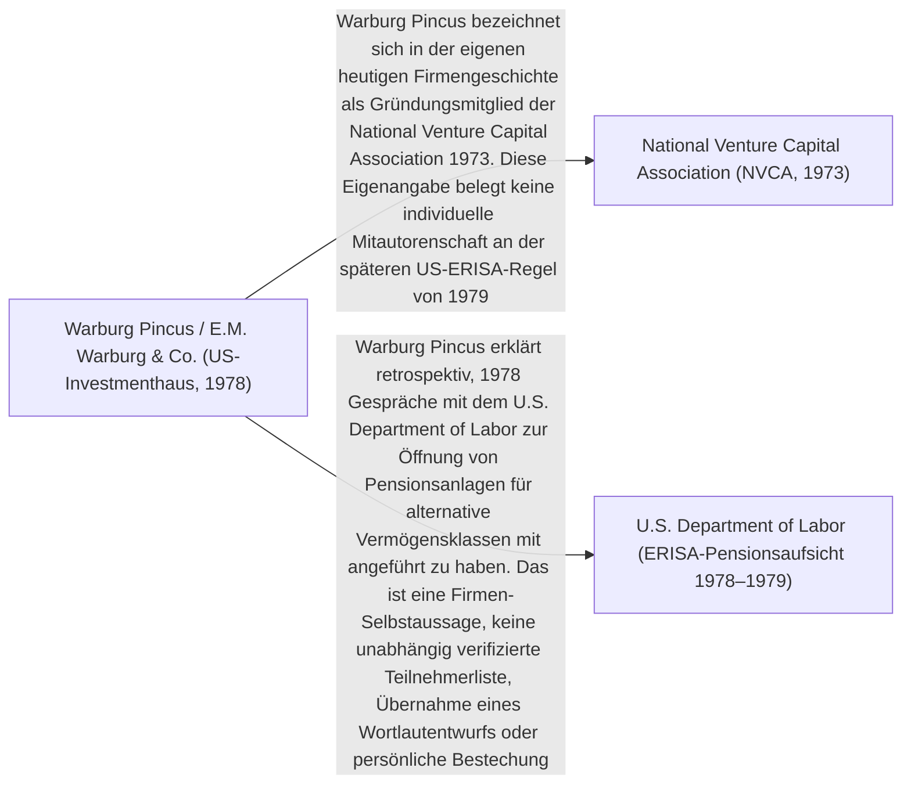

# Warburg Pincus / ERISA 1979 – direkte Beziehungen

**2 quellengebundene Beziehungen** mit Warburg Pincus / ERISA 1979 als Ausgangs- oder Zielakteur. Die Ansicht zeigt **nur unmittelbare Relationen**; sie beweist weder gemeinsame Steuerung noch Beziehungen zwischen den übrigen dargestellten Akteuren.

[Alle Fokusansichten](network-graph.md) · [Vollständige Relationstabelle](network.md)

## Quellen und Evidenz

| Relation | Richtung und anderer Akteur | Befund | Evidenz | Quellen |
|---|---|---|---|---|
| [REL-US-WP-NVCA-1973-001](network.md#rel-us-wp-nvca-1973-001) | → National Venture Capital Association (NVCA, 1973) | Warburg Pincus bezeichnet sich in der eigenen heutigen Firmengeschichte als Gründungsmitglied der National Venture Capital Association 1973. Diese Eigenangabe belegt keine individuelle Mitautorenschaft an der späteren US-ERISA-Regel von 1979 | stark gestützt | [SRC-US-WARBURG-PINCUS-FIRM-HISTORY-1978](../quellen/index.md#src-us-warburg-pincus-firm-history-1978) |
| [REL-US-WP-DOL-CONSULTATIONS-1978-001](network.md#rel-us-wp-dol-consultations-1978-001) | → U.S. Department of Labor (ERISA-Pensionsaufsicht 1978–1979) | Warburg Pincus erklärt retrospektiv, 1978 Gespräche mit dem U.S. Department of Labor zur Öffnung von Pensionsanlagen für alternative Vermögensklassen mit angeführt zu haben. Das ist eine Firmen-Selbstaussage, keine unabhängig verifizierte Teilnehmerliste, Übernahme eines Wortlautentwurfs oder persönliche Bestechung | plausibel | [SRC-US-WARBURG-PINCUS-FIRM-HISTORY-1978](../quellen/index.md#src-us-warburg-pincus-firm-history-1978) |
